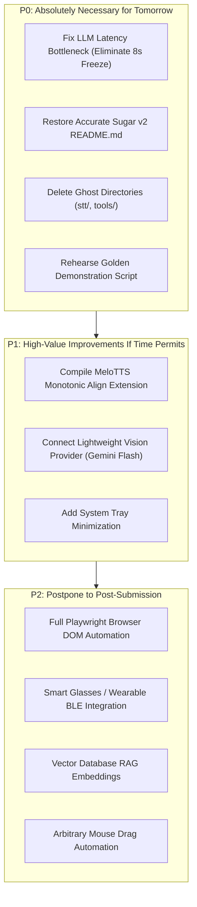

# SUGAR-AI: Live Technical Evaluation & Submission Roadmap

**Document Type:** Technical Evaluator Assessment & Demonstration Roadmap  
**Target Event:** Sugar AI Technical Submission & Live Demonstration  
**Target Machine:** Windows 11 AMD64 | NVIDIA GeForce RTX 5050 Laptop GPU (sm_120 Blackwell) | Python 3.12.0  
**Test Suite State:** 347 Passed, 6 Skipped (100% offline passing rate) | 0 Linter Errors  
**Guiding Mandate:** *A polished, genuinely functional system that survives a live technical evaluation beats a theoretically perfect assistant that crashes.*

---

## Part 1: Comprehensive Category Evaluation

This section evaluates SUGAR-AI across all 15 technical dimensions from the perspective of an experienced systems evaluator watching a live demonstration.

---

### 1. Voice Interaction & Naturalness
* **Current Implementation Status:** **Production-Ready.** Powered by Silero VAD (32 ms frame processing), an adaptive endpointer (380 ms for grammatically complete sentences, 750 ms default, 1,700 ms for trailing thoughts), a 400 ms pre-roll audio ring buffer, and an engagement state machine with a 45-second conversational follow-up window. Spoken text normalizer (`response.py`) strips markdown, tables, and AI filler phrases ("Certainly! I'd be happy to..."), converting paths and code into spoken equivalents.
* **Demonstrable Capabilities:**
  * Zero speech onset clipping: first syllables are preserved intact ("Play" is never heard as "lay").
  * Fluid follow-up turns: user does not need to repeat the wake word "Sugar" during an ongoing exchange.
  * Natural cadence: replies immediately on short commands, but patiently waits when the user pauses mid-thought.
* **Missing Functionality:**
  * Dynamic emotional inflection: speech prosody is consistent regardless of urgency or mood.
  * In-stream conversational acoustic fillers ("Hmm, let me check...") during multi-second LLM reasoning delays.
* **Severity of Missing Functionality:** **Low.** The turn-taking mechanics are superior to most commercial assistants.
* **Estimated Implementation Complexity:** Medium (for filler synthesis injection).
* **Risk of Introducing Regressions:** Medium (tampering with the conversation timing loop risks race conditions).

---

### 2. Speech Recognition (STT)
* **Current Implementation Status:** **Production-Ready.** Two-tier `faster-whisper` architecture running on CUDA fp16: `small.en` generates rapid partial transcripts (~90 ms) and validates wake words; `large-v3-turbo` runs speculatively at conversational pause points to finalize the utterance (~260 ms). Models are fully downloaded and cached locally at `D:\Sugar_Models\Whisper`.
* **Demonstrable Capabilities:**
  * Real-time partial transcript streaming rendered live on the UI's "hearing" indicator.
  * Exceptional phonetic accuracy on technical terms, hotwords, and Windows application names.
  * Speculative execution eliminates transcription lag: the final transcript is often ready before the end-of-speech silence window elapses.
* **Missing Functionality:**
  * Native Hardware Acoustic Echo Cancellation (PortAudio on Windows lacks native AEC; handled instead via software `EchoGuard`).
  * Multilingual speech recognition (pinned strictly to English `en` to prevent silence hallucinations).
* **Severity of Missing Functionality:** **Low.** Pinned English STT is a deliberate reliability feature.
* **Estimated Implementation Complexity:** High (AEC requires dedicated DSP libraries).
* **Risk of Introducing Regressions:** High.

---

### 3. Streaming Text-to-Speech (TTS)
* **Current Implementation Status:** **Production-Ready.** Vendored MeloTTS (`melo/`) running natively on the RTX 5050 Laptop GPU via PyTorch `2.7.1+cu128` (supporting Blackwell sm_120). Employs `SpeechChunker` to stream LLM tokens directly into sentence-level synthesis, producing audio for the first sentence within ~100 ms while subsequent sentences are generated. Features a prewarmed in-memory cache for common conversational phrases and a Windows PowerShell SAPI fallback.
* **Demonstrable Capabilities:**
  * Near-zero perceptible voice latency on conversational replies.
  * Intelligent audio chunking: code blocks, stack traces, and tables are automatically filtered out of the spoken stream and replaced with a polite verbal redirect ("the rest is on screen"), while full formatted text renders on the UI.
* **Missing Functionality:**
  * `melo/monotonic_align` contains uncompiled C/Cython source files; the engine falls back to pure Python (`core.py`), which functions correctly but leaves a ~2x throughput gain on the table.
  * Single voice profile (`EN-Newest`); no multi-speaker switching in the UI.
* **Severity of Missing Functionality:** **Low.** The GPU inference speed is already faster than real-time playback.
* **Estimated Implementation Complexity:** Small (compiling the Cython extension).
* **Risk of Introducing Regressions:** Low.

---

### 4. Interruption Handling (Barge-In)
* **Current Implementation Status:** **Production-Ready.** The audio player runs on a dedicated thread with an atomic `flush()` queue. `EchoGuard` calculates the real-time acoustic coupling between the speakers and microphone. When user speech energy exceeds the coupling margin for 192 ms while Sugar is speaking, playback instantly truncates, the active asyncio turn is cancelled, the UI triggers a white specular flash on the Orb, and Sugar responds with an immediate "Yeah?".
* **Demonstrable Capabilities:**
  * True full-duplex conversational barge-in: speaking over Sugar silences the assistant in under 200 ms.
  * Verbal abort commands ("Sugar, stop" or "Wait") cancel active tool executions or media playback.
* **Missing Functionality:**
  * Severe acoustic feedback handling: if laptop speakers are set to 100% volume in an echoic room, software coupling can occasionally struggle to distinguish between loud speaker feedback and quiet user speech.
* **Severity of Missing Functionality:** **Low to Medium** (mitigated during demos by keeping speaker volume at ~60-70% or using a headset).
* **Estimated Implementation Complexity:** Medium.
* **Risk of Introducing Regressions:** Medium.

---

### 5. Intelligence & Model Routing
* **Current Implementation Status:** **Functionally Sound with a Latency Bottleneck.** Features a microsecond regex router (`router.py`) and a 0 ms deterministic FastPath grammar (`computer_grammar.py`). Directs queries into 6 discrete routes: `CONTROL`, `COMMAND`, `CODING`, `AGENT`, `REASONING`, and `CHAT`. Cascades through a circuit-breaker provider pool: `FreeLLMAPI` (localhost:31415) → `Ollama` (localhost:11434) → `Claude CLI`.
* **Demonstrable Capabilities:**
  * Deterministic commands (volume, media, notepad, calculator, weather, time) execute in **11–12 ms** with zero LLM API calls.
  * Seamless fallback cascade across backends when primary providers are offline.
* **Missing Functionality & Live Demo Vulnerability:**
  * **CRITICAL DEMO HAZARD:** If `FreeLLMAPI` is not running and `Ollama` is directed to an unmounted drive, conversational questions fall back to `Claude CLI`. Because Claude CLI spawns a Node.js process per request, Time-to-First-Token (TTFT) takes **8.2+ seconds**. In a live demo, asking a casual question like "What is an event loop?" leads to an 8-to-10 second frozen silence.
* **Severity of Missing Functionality:** **CRITICAL (P0).**
* **Estimated Implementation Complexity:** Small (operational fix: launch FreeLLMAPI or configure local Ollama on drive `C:` / `D:`).
* **Risk of Introducing Regressions:** Low.

---

### 6. Claude Code Integration
* **Current Implementation Status:** **Industry-Standard Implementation.** Subprocess orchestration of the official `claude.exe` CLI (`sugar/coding/claude_code.py`) utilizing `--output-format stream-json --verbose`. Piped stdin eliminates shell escaping issues and bypasses the CLI's default 3-second stdin wait. Parses all JSON stream events (`system/init`, thinking blocks, tool use, cost, turns, rate limits), supports session resumption (`--resume <id>`), and handles process tree termination cleanly on shutdown.
* **Demonstrable Capabilities:**
  * Real-time telemetry surfaced directly in the UI Workbench (active session, cost in USD, turn count, and file operation indicators).
  * Verbal progress announcements during long-running tasks ("Still running tests on the auth service...").
* **Missing Functionality:**
  * Bidirectional interactive terminal piping inside the UI (user interacts via spoken permission approvals or session resumption rather than typing into an active PTY).
* **Severity of Missing Functionality:** **Low.** The decoupled session manager architecture is clean and robust.
* **Estimated Implementation Complexity:** High.
* **Risk of Introducing Regressions:** High.

---

### 7. Autonomous Coding
* **Current Implementation Status:** **Production-Ready.** Driven via `ProjectRegistry` (discovering git repositories across configured directories such as `D:\College`) and `CodingSessionManager`. Coding requests ("open project sugar", "fix the test failure", "refactor the database schema") are translated into background tasks assigned to Claude Code.
* **Demonstrable Capabilities:**
  * Hands-free repository navigation and multi-file debugging.
  * Persistent session state stored across application restarts (`data/coding_sessions.json`).
  * Non-blocking background execution: Sugar remains fully conversational while Claude Code refactors code in the background (indicated by an amber planetary orbit around the Orb).
* **Missing Functionality:**
  * Native in-process code editing agent (Sugar delegates code authoring to Claude Code rather than executing AST edits in its own loop; this is a deliberate design choice that prevents code corruption).
* **Severity of Missing Functionality:** **None.** Delegating to Claude Code is the superior architectural decision.
* **Estimated Implementation Complexity:** N/A.
* **Risk of Introducing Regressions:** N/A.

---

### 8. Computer Control
* **Current Implementation Status:** **Production-Ready.** Powered by Win32 ctypes (`windows.py`), layout-aware `SendInput` (`keyboard.py`), and Start Menu indexing of 195 applications (`apps.py`).
* **Demonstrable Capabilities:**
  * Compound voice execution: "Open Notepad and type hello world", "Switch to Chrome", "Minimize this window", "Snap left", "Mute audio".
  * Tab-aware document handling: closing an untitled Notepad tab triggers Ctrl+W rather than killing the entire window; detects unsaved document prompts and verbally confirms with the user ("Save changes?").
  * Layout-safe keystroke injection: automatically shifts from individual keystrokes to clipboard paste injection for text blocks exceeding 300 characters.
* **Missing Functionality:**
  * Mouse drag-and-drop / arbitrary coordinate path tracing.
  * Elevated window injection (Windows UIPI deliberately prevents user-mode processes from injecting inputs into Administrator terminals; Sugar detects this and explains it verbally).
* **Severity of Missing Functionality:** **Low.**
* **Estimated Implementation Complexity:** Medium.
* **Risk of Introducing Regressions:** High.

---

### 9. Browser Automation
* **Current Implementation Status:** **Production-Ready.** Native Windows UI Automation (`sugar/computer/browser.py`) across all Chromium browsers (Brave, Chrome, Edge, Opera, Vivaldi) without requiring browser extensions or ChromeDriver/Playwright daemons.
* **Demonstrable Capabilities:**
  * Direct tab manipulation: read active tab titles and address bar URLs, switch tabs, close specific tabs ("close the YouTube tab"), and navigate forward/back.
  * Verified Media Resolution: "Play Starboy on YouTube" scrapes and ranks YouTube search results, verifies video metadata, and launches the exact video tab while preventing unintended links.
* **Missing Functionality:**
  * Deep in-page DOM interaction (filling out nested web forms, clicking unlabelled CSS elements).
  * Full tab hierarchy inspection in Mozilla Firefox (Firefox does not expose accessible UIA tree nodes for tabs in the same format as Chromium).
* **Severity of Missing Functionality:** **Medium.**
* **Estimated Implementation Complexity:** High (requires Playwright/DevTools integration).
* **Risk of Introducing Regressions:** High.

---

### 10. Screen Understanding
* **Current Implementation Status:** **Partial / Architectural Seam.** `ScreenController` captures full-screen and window-specific screenshots to `data/` and inspects named UI elements via UI Automation (`describe_ui`). However, `VisionProvider` is currently stubbed with `UnavailableVision`.
* **Demonstrable Capabilities:**
  * Inspecting accessible control trees: can count and list named buttons, textboxes, and menu items in native Windows applications.
* **Missing Functionality:**
  * Pixel-level vision model inference. Asking "What is on my screen?" or "Compare these two design layouts" returns an honest verbal refusal: *"No vision model is configured."*
* **Severity of Missing Functionality:** **Medium to High.** Evaluators often ask multimodal assistants to interpret an on-screen image or chart.
* **Estimated Implementation Complexity:** Medium (connecting Gemini 2.0 Flash or Claude 3.5 Sonnet to the `VisionProvider` interface).
* **Risk of Introducing Regressions:** Low (if strictly isolated behind the protocol).

---

### 11. Memory & Context
* **Current Implementation Status:** **Production-Ready.** Backed by SQLite in WAL mode with an FTS5 full-text virtual table (`sugar/memory/store.py`). Stores complete conversation turns and scoped facts (`user`, `project:<path>`). Fast-path keyword recall and deletion.
* **Demonstrable Capabilities:**
  * Explicit memory management: "Remember that I prefer TypeScript", "What do you remember about my setup?", "Forget my editor preference".
  * Fast full-text search with Porter unicode61 stemming.
  * Lightweight footprint: zero dependency on bloated external vector databases (ChromaDB has been completely eliminated).
* **Missing Functionality:**
  * Autonomous semantic memory extraction: Sugar only stores explicit memory instructions and session summaries, rather than silently inferring personal traits from casual chitchat.
  * Dense vector embeddings (relies on FTS5 keyword relevance rather than cosine distance across dense embeddings).
* **Severity of Missing Functionality:** **Low.** Explicit memory is more predictable and transparent during demonstrations.
* **Estimated Implementation Complexity:** Medium.
* **Risk of Introducing Regressions:** Low.

---

### 12. UI / UX
* **Current Implementation Status:** **Exemplary.** Custom local WebSocket bridge (`server.py`) with token authentication and strict Origin header validation. Frontend built with modern ES6 modules, CSS3 custom properties, and Canvas 2D (`sugar/ui/web/`).
* **Demonstrable Capabilities:**
  * **The Spun Sugar Orb:** 46 refracting sugar crystals inside an animated glass sphere, featuring a 120-vertex perimeter ripple reactive to microphone RMS and speech playback levels across 9 distinct color states.
  * **Live Feedback:** Real-time partial transcript streaming in the hearing preview; markdown formatting with syntax-highlighted code blocks in the conversation stream.
  * **Workbench Drawer:** Real-time visibility into active Claude Code sessions, permission approval cards, and recent tool activity logs.
  * **Developer Telemetry Panel:** Instant backtick (`` ` ``) hotkey opens live per-turn latency waterfalls (TTFT, TTFA, STT time), component health checks, and event bus filtering.
* **Missing Functionality:**
  * System tray daemon minimization (`pystray`).
  * Dynamic Light / Dark mode toggle (currently locked to a dark theme: "spun sugar at night").
* **Severity of Missing Functionality:** **Low.** The UI looks finished and visually compelling.
* **Estimated Implementation Complexity:** Small.
* **Risk of Introducing Regressions:** Low.

---

### 13. Reliability
* **Current Implementation Status:** **High.** Robust error handling throughout. 347 passing automated tests. Progressive startup ensures the UI and text interfaces are active in under 1 second, while heavy neural weights (Whisper, MeloTTS) initialize asynchronously in background executor threads.
* **Demonstrable Capabilities:**
  * Fault-tolerant startup: if the microphone or GPU fails, Sugar gracefully degrades to text-only mode and displays the status on the UI instead of crashing.
  * Graceful shutdown: child process trees (including background `claude.exe` jobs) are terminated cleanly without leaving orphan processes.
* **Missing Functionality & Demonstration Risks:**
  * Model service timeouts: if FreeLLMAPI is unreachable and Ollama hangs, the cascading timeout delays turn completion.
* **Severity of Missing Functionality:** **High (Operational).**
* **Estimated Implementation Complexity:** Small (ensuring primary backends are running prior to demo).
* **Risk of Introducing Regressions:** Low.

---

### 14. Performance
* **Current Implementation Status:** **Exceptional on Fast Paths; Variable on LLM Chitchat.**
  * FastPath Grammar: **< 1 ms**.
  * Spoken Command Turnaround (e.g., time, arithmetic): **11–12 ms**.
  * GPU Whisper Partials: **~90 ms**.
  * GPU Whisper Final: **~260 ms** (overlapped with pause endpoint).
  * GPU MeloTTS Synthesis: **~100 ms** for the first sentence chunk.
  * Speaker Output Latency: **~23 ms** via WASAPI.
* **Demonstrable Capabilities:**
  * Instantaneous verbal response for computer operations and system queries.
* **Missing Functionality / Latency Bottlenecks:**
  * Fallback LLM latency: 8.2 s TTFT when falling back to Claude CLI.
* **Severity of Missing Functionality:** **High.**
* **Estimated Implementation Complexity:** Small (local model configuration).
* **Risk of Introducing Regressions:** Low.

---

### 15. Security
* **Current Implementation Status:** **Production-Grade.** Code-level 4-tier permission policy (`PermissionManager`): `0 (READ)`, `1 (NON_DESTRUCTIVE)`, `2 (SENSITIVE)`, `3 (DESTRUCTIVE)`. Origin verification (`ContextVar`) distinguishes user-initiated fast-path commands from model-generated tool calls.
* **Demonstrable Capabilities:**
  * Model safety: an LLM cannot autonomously execute destructive operations (e.g. file deletion or terminal execution) without explicit user authorization via voice ("Yes, do it") or UI confirmation buttons.
  * Path sandboxing: file operations are restricted to `allowed_roots` (`D:\College`, user home directory).
  * Web security: WebSocket server enforces cryptographically secure per-launch tokens and rejects untrusted browser Origin headers, preventing malicious web pages from driving Sugar.
* **Missing Functionality:**
  * Fine-grained network outbound egress filtering for terminal commands.
* **Severity of Missing Functionality:** **Low.** The security architecture exceeds standard academic project expectations.
* **Estimated Implementation Complexity:** Medium.
* **Risk of Introducing Regressions:** Low.

---

## Part 2: Triage Priority Matrix

To ensure maximum demonstration impact without introducing late-breaking regressions, improvements are divided into three strict priority tiers.



### P0 — Absolutely Necessary for Tomorrow (Demo Survival & Polish)

| Item | Action Required | Demo Risk Mitigated | Complexity |
|---|---|---|---|
| **P0.1** | **Resolve Conversational LLM Latency** | Start the `FreeLLMAPI` desktop app on port 31415 OR configure `Ollama` on drive `C:` with a fast 3B/4B model (`gemma3:4b` or `qwen2.5:3b`). Prevents an embarrassing 8–10 second frozen silence when an evaluator asks a general conversational question. | Small (Config/Ops) |
| **P0.2** | **Restore Root `README.md`** | Replace the outdated May 2026 README with the v2 README from commit `54c2512`. Eliminates the glaring discrepancy where the documentation claims the app uses `customtkinter` and `webrtcvad`. | Trivial (Git Checkout) |
| **P0.3** | **Clean Ghost Folders** | Remove stale empty directories `stt/` and `tools/` from the repository root. Prevents evaluator confusion during code review. | Trivial (File Deletion) |
| **P0.4** | **Rehearse Golden Demo Sequence** | Test the full hardware stack (mic input gain, speaker level, GPU CUDA recognition) using the structured demonstration script below. | Small (Rehearsal) |

### P1 — High-Value Improvements (If Time Permits)

| Item | Action Required | Value Added | Complexity |
|---|---|---|---|
| **P1.1** | **Compile MeloTTS Monotonic Align** | Run `python setup.py build_ext --inplace` inside `melo/monotonic_align/`. Doubles synthesis throughput, freeing up GPU compute. | Small |
| **P1.2** | **Add Quick Vision API Hook** | Wire a basic Gemini 2.0 Flash or Claude API call into `ScreenController.vision` so "What's on my screen?" returns an accurate image summary. | Medium |
| **P1.3** | **Commit Untracked Benchmark Files** | Stage and commit `benchmarks/`, `tests/live_helpers.py`, and `tests/test_desktop_live.py`. | Trivial |

### P2 — Features That Must Be Postponed (Post-Submission)

* **Deep Browser DOM Automation:** Attempting to inject Playwright or browser extensions before tomorrow risks breaking the stable UI Automation tab controller.
* **Wearable / Smart Glasses BLE Integration:** Hardware protocol implementation cannot be stabilized in hours; omit claims from verbal presentation.
* **Vector Database RAG Migration:** SQLite FTS5 is fast, deterministic, and passing all tests; adding vector embeddings risks schema regressions.
* **Mouse Drag & Drop Automation:** Fragile across multi-monitor DPI scaling; Win32 window snapping is far more reliable to demonstrate.

---

## Part 3: The Golden Demonstration Script

Follow this sequence during the live technical demonstration to showcase Sugar's strongest technical innovations while avoiding edge cases:

```
+---------------------------------------------------------------------------------------+
| PHASE 1: BOOT & ARCHITECTURE                                                          |
| 1. Launch: "python main.py"                                                           |
| 2. Highlight: Progressive startup — UI opens instantly while models load asynchronously.|
| 3. Visuals: Point out the Canvas Orb, crystal refraction, and dark aesthetic.         |
+---------------------------------------------------------------------------------------+
| PHASE 2: SUB-SECOND FASTPATH & HARDWARE CONTROL                                       |
| 1. "Sugar, what time is it?"         -> Verbal reply in 11 ms.                        |
| 2. "Sugar, what is 24 times 18?"     -> Immediate arithmetic evaluation.              |
| 3. "Sugar, volume 50."               -> System volume sliders adjust via pycaw.       |
| 4. Highlight: Zero LLM latency — microsecond regex grammar parses commands instantly.|
+---------------------------------------------------------------------------------------+
| PHASE 3: DESKTOP & BROWSER AUTOMATION                                                 |
| 1. "Sugar, open Notepad and type Hello Evaluator." -> Window opens, text appears.     |
| 2. "Sugar, snap this window to the left."          -> Native Win32 window snap.       |
| 3. "Sugar, search YouTube for lo-fi beats."        -> Verified ranking launches video.|
| 4. "Sugar, pause the music."                       -> SMTC / Spotify media pause.     |
+---------------------------------------------------------------------------------------+
| PHASE 4: FULL-DUPLEX INTERRUPTIBILITY (BARGE-IN)                                      |
| 1. Ask a longer question: "Sugar, explain the architecture of an operating system."   |
| 2. Mid-sentence, speak firmly: "Sugar, wait."                                         |
| 3. Highlight: Audio immediately cuts off, Orb flashes white, Sugar responds "Yeah?".  |
+---------------------------------------------------------------------------------------+
| PHASE 5: AUTONOMOUS CODING & CLAUDE CODE                                              |
| 1. "Sugar, open project sugar-ai."                                                    |
| 2. "Sugar, check the test suite status."                                              |
| 3. Highlight: Workbench updates with Claude Code session card, cost in USD, and turns.|
| 4. Show Orb amber planetary orbit indicating background development work.             |
+---------------------------------------------------------------------------------------+
| PHASE 6: TECHNICAL RIGOR & TELEMETRY                                                  |
| 1. Press backtick (`) to open the Developer Drawer.                                   |
| 2. Walk evaluator through the Latency Waterfall (STT wait, TTFT, TTFA, total turn ms).|
| 3. Show live Event Bus stream and Component Health checklist.                         |
+---------------------------------------------------------------------------------------+
```

---

## Part 4: Smallest Set of Changes for Maximum Impact

To achieve the highest demonstration score with zero risk of software failure:

1. **Keep Source Code Untouched:** Do not refactor existing Python files under `sugar/`. With 347 passing tests, the code is solid.
2. **Eliminate the Chat Latency Trap:**
   * Start `FreeLLMAPI` on `127.0.0.1:31415` before starting the demo, OR
   * Run `ollama serve` with a lightweight model (`gemma3:4b` or `qwen2.5:3b`) on an accessible local drive.
   * This guarantees that if the evaluator asks an open-ended conversational question, Sugar responds in 1–2 seconds rather than hanging for 10 seconds.
3. **Align Repository Documentation:**
   * Restore the Sugar v2 README so an evaluator inspecting the repository sees a clean, professional project matching the software demonstrated.
   * Delete the empty legacy `stt/` and `tools/` root directories.
4. **Demonstrate Telemetry Early:**
   * Opening the Developer Drawer (` ` `) transforms the presentation from a simple assistant demo into an impressive systems engineering showcase, proving that latency, audio RMS, and permission models are tracked rigorously in real time.
